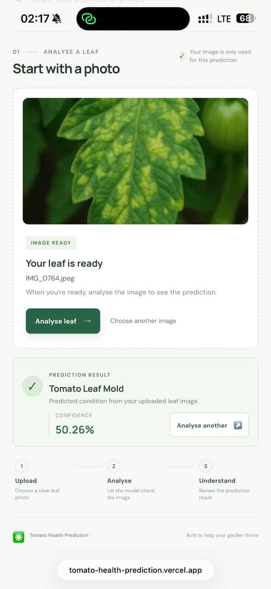
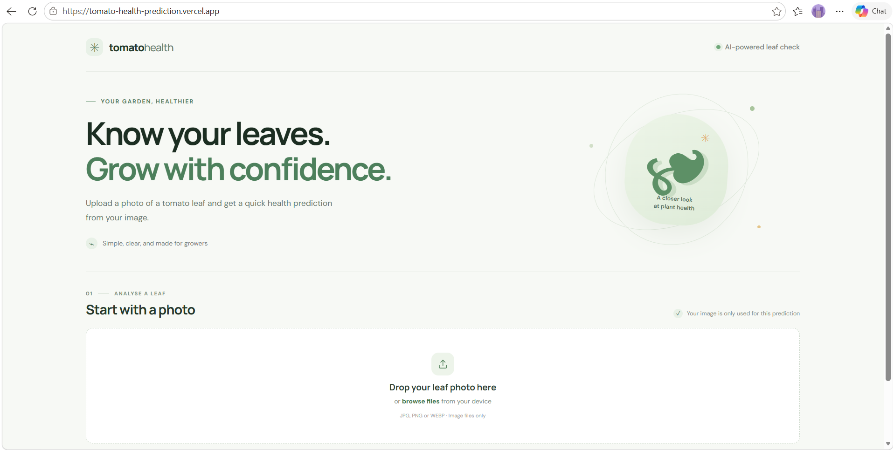
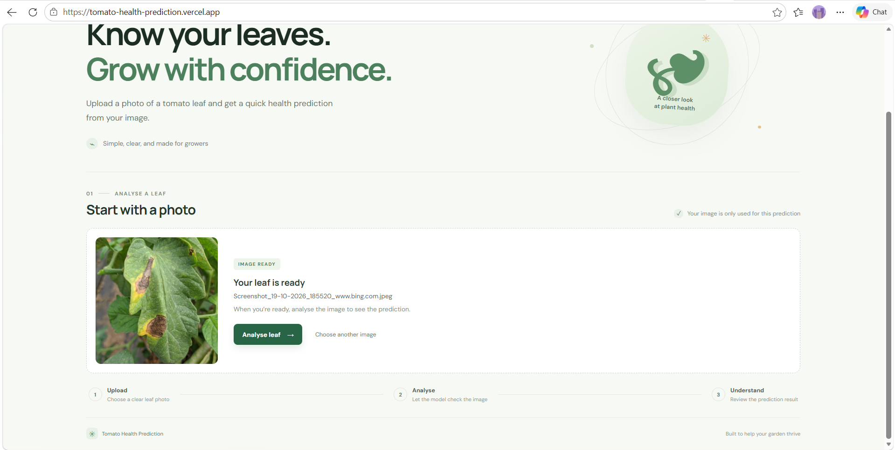
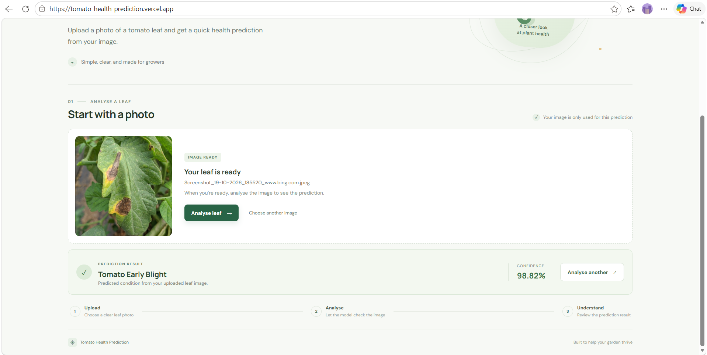

# Tomato Health Prediction

A full-stack tomato leaf image classifier. Upload a leaf photo in the web app to receive one of ten predicted conditions and the model's confidence score. The project combines a React/Vite interface, a FastAPI prediction service, and a TensorFlow/Keras convolutional neural network.

> **Note:** This is an educational image-classification project, not a diagnosis or a substitute for advice from an agricultural expert.

## Live demo

- **Web app:** [Tomato Health Prediction](https://tomato-health-prediction.vercel.app)
- **Prediction API:** [Render service](https://tomato-health-prediction.onrender.com)
- **API health check:** [GET /ping](https://tomato-health-prediction.onrender.com/ping)

The frontend uses the Render API URL as its default. For a different API deployment, set `VITE_API_URL` in the frontend environment and rebuild/redeploy.

## Features

- Upload or drag and drop a tomato leaf image.
- Preview the selected image before analysis.
- Receive a predicted class and confidence score.
- Start another prediction without reloading the page.
- Use the deployed Vercel frontend with the FastAPI backend on Render, or run both services locally.

The model predicts one of these classes:

1. Bacterial spot
2. Early blight
3. Late blight
4. Leaf mold
5. Septoria leaf spot
6. Two-spotted spider mites
7. Target spot
8. Tomato yellow leaf curl virus
9. Tomato mosaic virus
10. Healthy

## Screenshots

Screenshots from the deployed app on mobile and desktop. Predictions and confidence scores can vary with the uploaded image.

### Mobile



### Desktop

| Opening page | Selected image preview |
| --- | --- |
|  |  |

**Prediction result:**



## Tech stack

- **Frontend:** React, Vite, JavaScript, CSS
- **Backend/API:** Python, FastAPI, Uvicorn
- **Machine learning:** TensorFlow/Keras, NumPy, Pillow
- **Deployment:** Vercel (frontend), Render (API)

## How it works

1. The browser accepts an image and shows a local preview.
2. When the user selects **Analyse leaf**, the frontend sends the image as multipart form data in the `file` field to `POST /predict`.
3. FastAPI reads the uploaded image and passes it to the saved Keras model at `model/1.keras`.
4. The API chooses the highest scoring class and returns JSON containing `class` and `confidence`.
5. The frontend displays the returned class and confidence as a percentage.

The model's preprocessing pipeline resizes images to 256 × 256 pixels, scales pixel values, and applies random flips and rotations during training. The training notebook defines a sequential CNN with five convolution and pooling blocks and a three-layer dense classifier. The model has 10 output classes.

## Model evaluation

The notebook's saved test evaluation output reports **91.58% accuracy** and **0.2397 loss**. These values are transcribed from the existing notebook output; they have not been independently rerun as part of this README update. The notebook loads 16,011 images across 10 classes and trains for 20 epochs. Treat the reported score as a result from that recorded run, not a guarantee of performance on new images or field conditions.

## Run locally

You will need Python, Node.js, and npm installed.

### 1. Start the backend

Run these commands from the repository root so the API can find `model/1.keras`:

```bash
python -m venv .venv
```

Activate the virtual environment, then install the backend packages and start FastAPI:

```bash
# Windows PowerShell
.venv\Scripts\Activate.ps1
python -m pip install -r api/requirements.txt
python -m uvicorn api.main:app --host 127.0.0.1 --port 8000
```

```bash
# macOS / Linux
source .venv/bin/activate
python -m pip install -r api/requirements.txt
python -m uvicorn api.main:app --host 127.0.0.1 --port 8000
```

Check the API at <http://127.0.0.1:8000/ping>.

### 2. Start the frontend

In a second terminal:

```bash
cd frontend
npm install
```

Create `frontend/.env.local` with the local API URL:

```dotenv
VITE_API_URL=http://127.0.0.1:8000
```

Then run the Vite development server:

```bash
npm run dev
```

Open the local URL printed by Vite, usually <http://localhost:5173>. Vite reads `VITE_API_URL` when it starts, so restart the dev server after changing it.

## Deployment notes

- **Vercel:** Set the frontend project root to `frontend`. If configuring the API URL explicitly, set `VITE_API_URL` to the public API base URL (for example, `https://tomato-health-prediction.onrender.com`) for the relevant deployment environments, then redeploy.
- **Render:** The API needs the repository root as its working directory because it loads `model/1.keras` by a repository-relative path. A typical start command from the repository root is `uvicorn api.main:app --host 0.0.0.0 --port $PORT`.
- The backend allows the deployed Vercel origin and `http://localhost:5173`. For a different frontend domain, set the Render variable `FRONTEND_ORIGINS` to the frontend origin (or comma-separated origins), then redeploy the API.

## Repository layout

```text
api/                         FastAPI application and Python dependencies
frontend/                    React/Vite web app
model/1.keras                Saved TensorFlow/Keras model
dataset/                     Labeled tomato leaf image folders
tomato_health_prediction.ipynb  Model training and evaluation notebook
```

## Limitations

- The model only supports the ten classes listed above. It is not designed to identify other plant species, unrelated leaf problems, or multiple simultaneous conditions.
- Prediction quality can change with lighting, image quality, camera angle, background, and differences between training images and real-world field photos.
- The returned confidence is the model's score for its selected class; it should not be treated as a calibrated probability or proof of disease.
- The app does not provide treatment recommendations or replace professional diagnosis.
- The API currently reads the uploaded image and runs inference without an explicit file-size limit or detailed image validation. Use appropriate care when exposing it publicly.
- The first request to a hosted backend may take longer if the hosting service has been idle.


